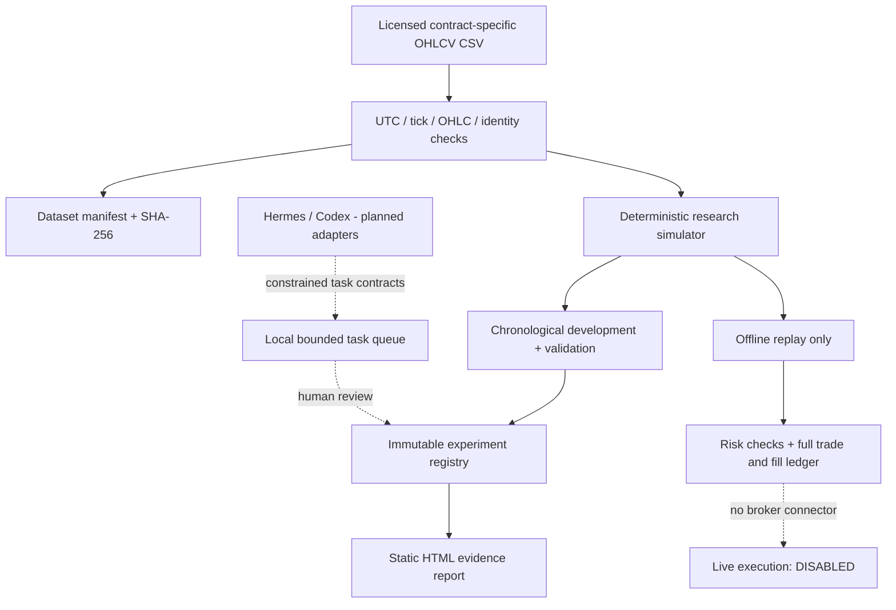

# Agent Quant Lab

**An evidence-first research environment for developing, testing and challenging systematic MNQ futures strategies.**

[Status: Research-only](#current-capabilities) · [Quick start](#quick-start) · [Architecture](#architecture) · [Verification](#verification) · [Roadmap](docs/ROADMAP.md) · [Known limitations](docs/BLOCKERS.md)

> [!IMPORTANT]
> **This is not a profitable trading bot, production brokerage client or live paper-trading service.** All built-in examples are fabricated. The software makes no live orders, cannot auto-promote candidates and cannot replace strategies unattended. Historical profitability, even on real data, does not establish a future trading edge.

Agent Quant Lab is built around one principle: **a research result is only as credible as its input data, execution assumptions, experimental controls and independent verification.** It provides a small, fully inspectable foundation for a more autonomous Hermes + Codex research system without making AI models responsible for exchange execution.

## At a glance

| Layer | Current implementation | Status |
| --- | --- | --- |
| Instrument | Explicit MNQ contract IDs, tick size, multiplier and tick value | Implemented, one contract/run |
| Market data | Strict UTC OHLCV CSV ingestion, corruption checks, checksum, immutable manifests, interval warnings | Implemented, file-based |
| Backtesting | Two transparent signal rules, next-bar-open fills, long/short, costs, cash ledger, daily loss guard | **Simplified bar simulator** |
| Validation | Chronological splits, rolling validation folds, sensitivity matrix, reserved holdout | Implemented baseline; statistical rigour incomplete |
| Research memory | SQLite immutable experiment payloads, review decisions and audit events | Implemented |
| Agents | Named roles, constrained task states and controlled handoffs | Local protocol; **not Hermes-connected** |
| Paper | Offline historical replay with tamper-evident event journal | Implemented, **not live paper** |
| Dashboard | Offline HTML equity chart, trade table and escaped JSON evidence | Implemented, no interactive live UI |
| Notifications | Preview + opt-in allowlisted one-shot sender (delivery not tested live) | Implemented, **not sent** |
| NautilusTrader | Planned independent engine integration | Not implemented |
| Live market feed | Licensed CME market-data connection | Not implemented |
| Broker connection | No broker or order placement code | Intentionally absent |

### What makes this foundation different

- **No invented data access.** There are no secret data downloads or unverified brokerage integrations; you supply licensed historical files.
- **Honest accounting boundaries.** The simulator records fills, trades and equity; intraday Sharpe is not invented; optional UTC-calendar-day diagnostics require sufficient days.
- **Inspectable experiments.** Results are content-addressed in SQLite and never rewritten. CSV imports include source checksums and explicit instrument identification.
- **Constrained agent delegation.** The coordinator may route bounded tasks, but validation roles and human approvals are not replaced by an LLM's opinion.
- **Fail-closed defaults.** No auto promotion, no external execution and no remote dashboard exposure.

## Quick start

Requires Python **3.11+**. Tested locally with Python **3.13**; no external runtime dependencies for the core CLI.

```bash
git clone https://github.com/Itskorrah/agent-quant-lab.git
cd agent-quant-lab
python -m venv .venv
# Windows PowerShell: .venv\Scripts\Activate.ps1
# macOS/Linux: source .venv/bin/activate
python -m pip install -e .
python -m quantlab demo --out runs/demo
```

Open `runs/demo/report.html` in your browser. The CLI also saves fabricated price bars and the complete JSON report. **Do not interpret synthetic performance as evidence of a tradeable strategy.**

### Work with actual historical data

Provide a *licensed* CSV file from your chosen data provider. The source must use exactly one **actual** MNQ futures contract (for example a valid provider instrument ID or a month/year-specific symbol); do not label an adjusted continuous series as executable prices.

Required CSV columns:

```csv
timestamp,open,high,low,close,volume,contract_id
2026-01-05T14:30:00+00:00,20000.00,20001.00,19999.75,20000.50,123,MNQ-EXAMPLE-202603
2026-01-05T14:31:00+00:00,20000.50,20002.00,20000.25,20001.25,110,MNQ-EXAMPLE-202603
```

`MNQ-EXAMPLE-202603` is a *format illustration*, not an authenticated exchange or provider identifier. Import a real provider ID for your dataset.

```bash
python -m quantlab import-csv \
  --csv path/to/your-bars.csv --contract ACTUAL_CONTRACT_ID \
  --provider YOUR_PROVIDER --licence "Your valid data entitlement" \
  --dataset data/mnq-sample --seconds 60

python -m quantlab research \
  --csv path/to/your-bars.csv --contract ACTUAL_CONTRACT_ID \
  --strategy breakout --registry runs/registry.db \
  --out runs/research/report.json

python -m quantlab html \
  --report runs/research/report.json --out runs/research/report.html

python -m quantlab replay \
  --csv path/to/your-bars.csv --contract ACTUAL_CONTRACT_ID \
  --out runs/replay/report.json

python -m quantlab journal-verify --file runs/replay/report.jsonl

python -m quantlab walk-forward \
  --csv path/to/your-bars.csv --contract ACTUAL_CONTRACT_ID \
  --folds 3 --gap 2 --out runs/validation/folds.json

python -m quantlab sensitivity \
  --csv path/to/your-bars.csv --contract ACTUAL_CONTRACT_ID \
  --out runs/validation/sensitivity.json
```

On Windows PowerShell, enter commands on one line or replace bash `\` continuations with PowerShell backticks. The backtester needs at least 120 bars for a complete development/validation split with default settings; more observations are needed for credible research.

The importer rejects malformed prices, off-tick values, non-UTC timestamps, duplicates and contract-ID mismatches. Session closures can appear as unexpected intervals: the importer **flags them**, because automatically inserting bars would invent prices.

**Reminder:** Importing real data does not make the output a production-quality futures backtest. Contract rolls, session calendars, accurate margin, realistic microstructure fills and an independent simulation engine remain necessary.

## Architecture



**Core entry points**

| Path | Responsibility |
| --- | --- |
| `quantlab/market.py` | Instrument specs, CSV parser, integrity checks, synthetic fixtures |
| `quantlab/sim.py` | Next-open signal/fill model, simulated trades, risk and account metrics |
| `quantlab/research.py` | Chronological partitions, reserved holdout, conservative quality gate |
| `quantlab/registry.py` | Content-addressed SQLite research history and review log |
| `quantlab/orchestration.py` | Task schema, finite-state queue and allowed agent-to-agent handoffs |
| `quantlab/dashboard.py` | Offline HTML equity curve, fills/trades and escaped evidence |
| `quantlab/validation.py` | Rolling chronological folds and pre-holdout cost/parameter sensitivity |
| `quantlab/journal.py` | Replay events with chained SHA-256 and integrity verification |
| `quantlab/bridge.py` | Validates constrained untrusted JSON task requests for future Hermes integration |
| `quantlab/telegram.py` | Opt-in HTTPS sender, credential allowlist; only mocked locally |
| `quantlab/notifications.py` | Message formatter that never sends Telegram messages |
| `quantlab/cli.py` | Entry point for demo, import, research, replay and report export |
| `tests/` | Executable regression and failure-path checks |

### Telegram (explicit one-time send only)

`python -m quantlab notify-preview --type research_complete --reason "Review report"` formats a message without any network traffic. To enable a **single** message, set `QUANTLAB_TELEGRAM_BOT_TOKEN`, `QUANTLAB_TELEGRAM_CHAT_ID` and `QUANTLAB_TELEGRAM_ALLOWED_CHATS` as **local environment variables**, with the chosen chat ID included in the allowlist. Then explicitly run `python -m quantlab notify-send --type research_complete --reason "Review report" --confirm-send`. Never put secrets in repository files or shell history. This has only been verified using a mocked network response, not a real Telegram bot.

### Model-to-engine trust boundary

Hermes agents are **untrusted research collaborators**, not trading authorities. They may propose hypotheses and isolated code changes. Deterministic modules validate data and calculate results. Development code must be reviewed, tested and committed before inclusion in an experiment. A researcher cannot independently modify the independent validator or risk policy. The existing workflow has **no** programmatic LLM or Codex integration; see [Hermes contract](docs/HERMES.md).

### Honest backtest limitations

The built-in simulator is a transparent *engineering fixture*, not an exchange-grade simulation. It assumes signals after a completed candle and fills at the next candle's open with configurable adverse slippage and explicit fees. Bar-close emergency liquidation is an approximation; a price gap may execute much worse than assumed. UTC calendar-day risk is not the CME session boundary. The margin assumption is illustrative rather than a current broker requirement. The simulator does not model stops, order-book liquidity, limit-order queues, contract rolls, latency or partial fills. Validation partitions warm up separately and the holdout is not calculated by the routine research command.

If your strategy relies on intra-minute price ordering, tight stops or liquidity, **do not use this engine to judge its profitability**. Replace it with a vetted, event-driven market model using suitable historical data. A future NautilusTrader integration must be *independently tested* against hand-calculated cases before promotion.

## Verification

```bash
python -m pip install -e '.[dev]'
python -m pytest -q
python -m quantlab demo --out runs/demo
```

Tests include timestamp and contract consistency, tick constraints, gap reporting, ledger consistency, adverse costs, future-information isolation, illustrative margin/risk restrictions, holdout access, experiment immutability, queue transitions, HTML escaping and the end-to-end synthetic demo. Passing these checks does **not** certify data quality from a vendor, profitable execution, security or reliable unattended service operation.

## Delivery and operational principles

- Keep `main` stable and prefer feature branches with independently reviewed changes.
- Never commit `.env`, credentials, purchased datasets, user research records or broker keys.
- Experiments and downloadable datasets live under ignored `runs/` and `data/` directories.
- Use deterministic tests and inspect actual logs; distinguish code present from integrations exercised.
- Run locally first. An always-on deployment would require additional monitoring, backups and risk recovery.
- Paid GitHub Actions workflows are intentionally not enabled, to preserve limited Actions minutes.

## Roadmap and known blockers

Detailed priorities: [Roadmap](docs/ROADMAP.md). Unverified integrations and constraints: [Blockers](docs/BLOCKERS.md). Engineering audit and Evolve method: [Evolve](docs/EVOLVE.md). Hermes design: [Hermes](docs/HERMES.md).

### Contribution

Read [AGENTS.md](AGENTS.md) before coding. Contributions should include a reproducible problem statement, acceptance tests and the exact source/data provenance. New strategy types must use completed-bar signals and be regression tested for lookahead and accounting errors. Failing validation is an expected research outcome.

## Disclaimer

This code is for experimentation, education and software research. It is **not financial advice**, not a trading recommendation and not evidence that any automated strategy will be profitable. Leveraged futures trading carries substantial financial risk. No use of live capital is authorised by this project.
